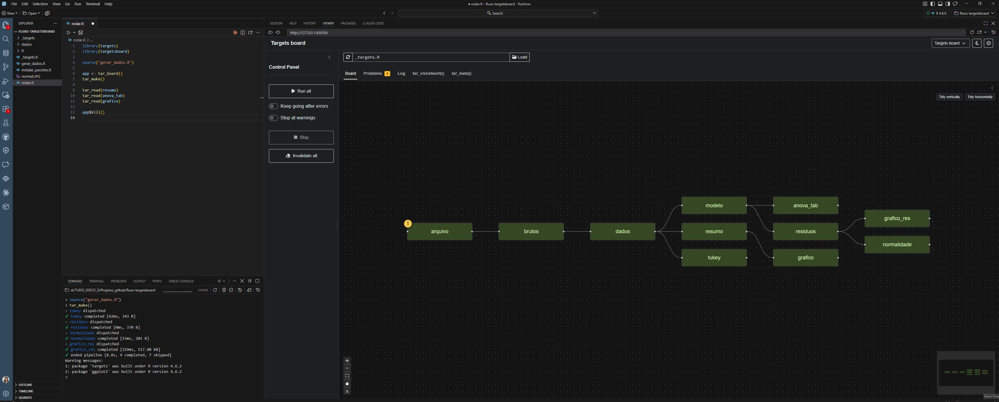

# Fluxo com targets e targetsboard

Pipeline simples em R para analisar um ensaio de cultivares em delineamento de blocos casualizados (DBC), organizado com o [targets](https://docs.ropensci.org/targets/) e acompanhado pelo [targetsboard](https://github.com/Athospd/targetsboard), pacote de Athos Damiani.



## O que o pipeline faz

Os dados são simulados, com 4 cultivares, 4 blocos e uma parcela perdida. O pipeline tem 11 etapas.

| Etapa | Descrição |
|---|---|
| `arquivo` | monitora o arquivo `dados/ensaio.csv` |
| `brutos` | lê os dados |
| `dados` | remove a parcela perdida |
| `resumo` | média e desvio padrão por cultivar |
| `grafico` | gráfico de barras das médias |
| `modelo` | ajusta o modelo `produtividade ~ bloco + cultivar` |
| `anova_tab` | tabela de análise de variância |
| `tukey` | comparação de médias pelo teste de Tukey |
| `residuos` | valores ajustados e resíduos do modelo |
| `grafico_res` | gráfico de resíduos |
| `normalidade` | teste de Shapiro-Wilk dos resíduos |

## Estrutura

```text
fluxo-targetsboard/
├── _targets.R          # definição do pipeline
├── rodar.R             # ordem de execução
├── R/
│   └── funcoes.R       # funções usadas pelo pipeline
├── scripts/
│   ├── instalar_pacotes.R
│   └── gerar_dados.R
└── dados/
    └── ensaio.csv
```

## Como rodar

Abra a pasta do projeto no RStudio ou no Positron e execute o `rodar.R` linha a linha.

```r
source("scripts/instalar_pacotes.R")   # só na primeira vez
source("scripts/gerar_dados.R")        # opcional, o CSV já está no repositório

library(targets)
library(targetsboard)

app <- tar_board()   # abre o board
tar_make()           # roda o pipeline

tar_read(tukey)      # lê o resultado de uma etapa
app$kill()           # encerra o board
```

Eu instalei pelo GitHub dentro do `instalar_pacotes.R`. Ele precisa do shiny na versão 1.12 ou mais recente.

## Para testar

- Altere os efeitos das cultivares em `scripts/gerar_dados.R`, rode o script e clique em **Refresh** no board. Todo o pipeline fica desatualizado.
- Altere a cor do gráfico em `R/funcoes.R`. Apenas a etapa `grafico` fica desatualizada.

## Autora

Jennifer Luz Lopes, [Café com R](https://jenniferlopes.quarto.pub/portifolio)